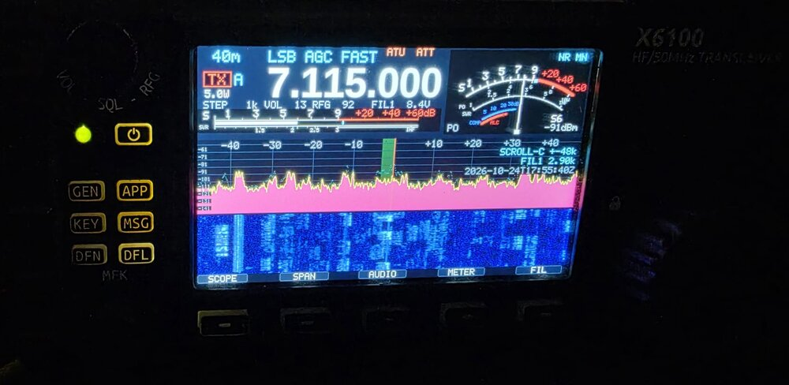
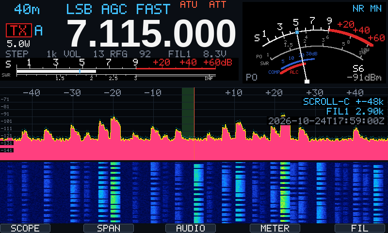
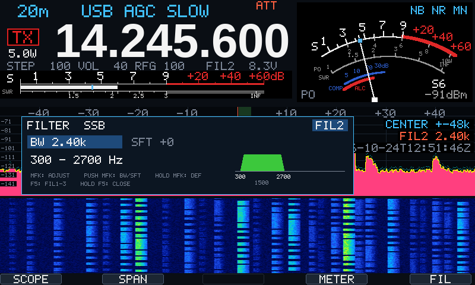
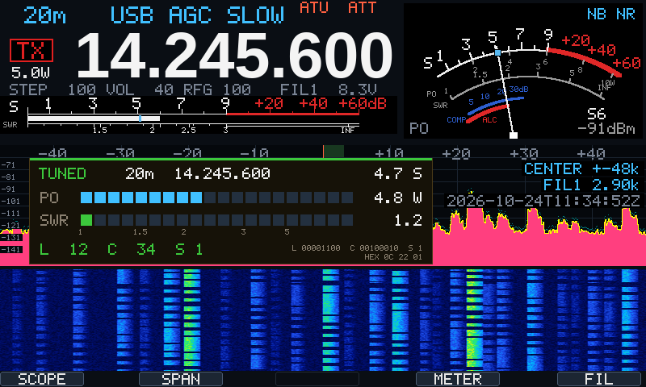
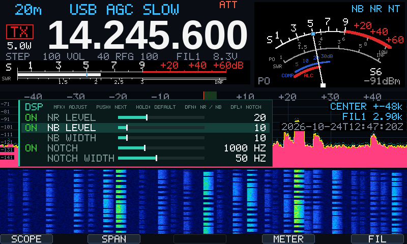
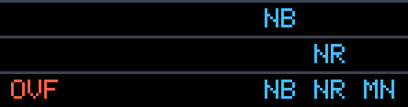
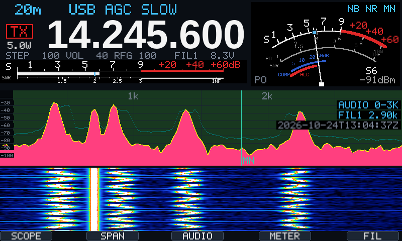

# libx6100

Open-source C control library for the Xiegu X6100 baseband (STM32), used from the
Allwinner R16 running Linux. Written from scratch from the stock Xiegu
APP 1.2.0 / BASE 1.1.9 interface; contains no R1CBU, Aether or Xiegu code.

Goal: replace the R1CBU control layer and the patched baseband dependency with an
independent, documented library, as the base for a new front end.



`x6100_trx` on the X6100 (stock BASE 1.1.9), 20 m SSB, 2026-10-24. Key reference
in `docs/x6100_trx_quickref.md`.



The same screen rendered by its own drawing code, with 20 m SSB activity modelled
on the photo (stations every few kHz, voice in syllables on the waterfall).



Filter panel (hold F5), IC-705 style: MFK sets BW or SFT, per mode group and FIL1-3.



Tune panel (hold ATU): amber TUNING with live PO and SWR while the tuner searches,
then green TUNED for 4 s with the time taken and the network it settled on (L, C, S
in decimal, as relay bits and in hex).



DSP panel (hold DFL): the baseband's noise reduction, noise blanker and manual notch;
MFK adjusts the selected value, DFN / DFL switch NR, NB and notch.



Indicators on the S-meter dial (2x): NB, NR and MN (manual notch, as on Icom) each in a fixed place at
the top right, so none moves when another switches; OVF in red at the top left when
the flow IQ reaches its clip level.



Audio scope (F3): the demodulated RX audio, 0-3 or 0-6 kHz (F2), with the receive
passband and the manual notch (render with synthetic speech and a CW tone).

## Status

Verified on hardware (BASE 1.1.9), see `docs/x6100_control_interface.md` §9:

- status block, calibration read with CRC check
- flow frames (IQ + telemetry), CRC checked
- register file, full and diff writes
- RX tuning: frequency, mode, filter, band, volume, per-band calibration
- front panel input (keys, encoders, power key)
- display: own receiver screen with S-meter, spectrum, waterfall
- RX audio capture over ALSA (48 kHz stereo, no libasound); FT8 recording decodes in `jt9`
- TX: ATU tune, carrier, and codec audio as modulation (tone into a dummy load, verified on a separate receiver)

Not yet: GPIO, CI-V, TX from the receiver UI.

## Layout

| Path | Content |
|------|---------|
| `include/x6100.h` | public API |
| `include/x6100_regs.h` | register map, packing macros |
| `include/x6100_cal.h` | calibration block layout (0xF000) |
| `include/x6100_keys.h` | front panel keys and encoders |
| `include/x6100_lcd.h` | display (DRM/KMS), drawing API |
| `src/x6100.c` | baseband implementation |
| `src/x6100_lcd.c` | display implementation, 5x7 and anti-aliased text |
| `include/x6100_pcm.h` | ALSA PCM via kernel ioctls (no libasound) |
| `src/x6100_pcm.c` | PCM implementation |
| `src/x6100_font_freq.c` | frequency digits, Liberation Sans Bold 80 px (OFL-1.1), generated |
| `tools/x6100_info.c` | read-only check: version, calibration, flow |
| `tools/x6100_rodump.c` | raw dump of status and calibration blocks |
| `tools/x6100_tune.c` | RX-only tuning test, TX blocked |
| `tools/x6100_input.c` | front panel event dump |
| `tools/x6100_lcdtest.c` | display probe and test pattern |
| `tools/x6100_audio.c` | record RX audio to WAV with levels; `--iq` tests auxiqen |
| `tools/x6100_tx.c` | controlled TX tests: ATU tune, carrier, codec tone; hard limits |
| `tools/x6100_i2csniff.c` | LD_PRELOAD logger for register writes of another UI (glibc build) |
| `x6100_rx` (binary) | `tools/x6100_trx.c` built with `-DX6100_RX_ONLY`: receiver, never transmits |
| `tools/x6100_trx.c` | transceiver: x6100_rx plus PTT, ATU, TX power, TX meters |
| `tools/x6100_spk.c` | experiment, negative: speaker through Linux via reg 12 bit 0x8 (capture loses RX audio in play mode), kept for reference |
| `tools/x6100_iqcal.c` | RX IQ image calibration attempt (registers 48/49); parked: flow IQ too little range to measure |
| `scripts/x6100_ui.sh` | stop/start the GUI (stock and R1CBU images) |
| `docs/x6100_control_interface.md` | protocol documentation |
| `docs/x6100_netaudio_design.md` | network audio / wfview design (draft) |
| `docs/x6100_baseband_handover.md` | handover for a separate baseband-firmware (clean-room) discussion |

## Build

Cross-compile on openSUSE Tumbleweed:

```
zypper install zig
bash build.sh
```

Output in `out/`: `libx6100.a` and static ARM tools.

`build.sh` first does `git pull --ff-only`, then builds only when a source file, the
script or the zig version changed (fingerprint in `out/.fingerprint`).

```
bash build.sh                 # pull, build if needed
bash build.sh deploy          # ... and scp x6100_trx, x6100_ui.sh, the quick reference
X6100_HOST=root@192.168.1.61 bash build.sh deploy
bash build.sh -f --no-pull    # force a build, no pull
```

`deploy` copies to `$X6100_HOST:/root` (default `root@x6100`).

## Run on the radio

```
scripts/x6100_ui.sh stop
./x6100_info
./x6100_tune 14074000 usb 30 20
scripts/x6100_ui.sh start
```

The GUI must be stopped: it writes the same bus every millisecond.

## Test setup and thanks

Development and the pictures above are done on an X6100 that boots the operating
system and GUI image by Giovanni Ricciardi IU1WXY
([github.com/IU1WXY](https://github.com/IU1WXY)), with the stock Xiegu baseband
(BASE 1.1.9). `scripts/x6100_ui.sh stop` stops his GUI so that `x6100_trx` owns the
baseband, and `start` brings it back. Many thanks to IU1WXY for a well-kept image to
boot from. libx6100 contains no code from it.

## Safety

- No function writes the calibration block; keep your own dump as backup.
- `x6100_trx` keys TX from the PTT key: amateur bands only, 180 s timeout, SWR > 3 for 300 ms drops TX.
- `x6100_tx` (test tool) keys the transmitter: 0.1-10 W (default 1 W), max 30 s, amateur bands only,
  3 s countdown, stops on any key, Ctrl-C or SWR > 3. Use a dummy load.
- All other tools never set PTT.

## License

GPL-3.0-or-later, see `LICENSE`.

`src/x6100_font_freq.c` contains glyph bitmaps rendered from Liberation Sans Bold,
licensed under the SIL Open Font License 1.1 (Copyright (c) 2012 Red Hat, Inc.).
