# x6100_trx — quick reference

Transceiver front end for the X6100 on stock BASE 1.1.9, driven by the front
panel. `x6100_rx` is the same program, receive only (PTT and tune refused).

## Start

Stop the stock GUI first (`scripts/x6100_ui.sh stop`). That also starts wfserver when it is
installed and set up (`contrib/wfserver`): it runs while x6100_trx serves `cat pty`;
`x6100_ui.sh wfserver off` / `on` switches that off / on, `x6100_ui.sh start` stops it.

```
x6100_trx [--oob] [--no-limit] [--cat[=baud|pty]] [--cat-log] [--probe] [freq] [mode] [agc] [att|noatt] [pre|nopre] [vol 0-100]
x6100_trx 7074000 lsb vol 30
x6100_trx --oob 5450000 usb slow
```

| Option | Effect |
|---|---|
| `--oob` | no band check before TX, baseband TX enabled everywhere (transverter, tests; legal limits are yours) |
| `--no-limit` | tune 10 kHz - 100 MHz instead of 0.5 - 56 MHz (baseband probe); put it before the frequency |
| `--cat[=baud\|pty]` | CI-V as an IC-705 on /dev/ttyS2 (DEV USB-C, PC side the second CH342 port, e.g. ttyACM1), 4800-19200, default 19200 (the most the DEV port carries); `pty`: on a pseudo-terminal, /tmp/x6100-civ, any speed, for a client on the radio (wfserver, rigctld, socat). See `docs/x6100_civ.md` |
| `--cat-log` | as `--cat`, and print CI-V commands (`>`) with our OK / NG reply (`<`); polls answered with data are not shown |
| `--probe` | print the flow flag word on change, and every second the IQ peak and all flag bits seen (overflow hunt) |

Out-of-range frequency arguments are refused (a stray `20` is not 20 Hz).

## Front panel

| Control | Short | Long |
|---|---|---|
| VFO knob | tune | |
| FST | step 10 / 100 / 1000 / 5000 Hz; AM on LW / MW: 100 / 1k / 5k / 9k / 10k (channel raster); 60 m: 10 / 100 / 1k / 5k / CH (MFK picks the 60 m channel, the VFO knob fine-tunes in 100 Hz) | 1 Hz step on / off |
| VOL knob | volume; push = mute | |
| MFK knob | RF gain or TX power | |
| MFK push | RF gain 100 / TX power 5.0 W | switch RF gain <-> TX power |
| BAND- / BAND+ | previous / next band (last frequency per band kept): 160m .. 6m, GEN, 160m; GEN is everything outside the ham bands (last frequency and mode there; 10.000 MHz AM out of the box; state `gen <Hz> <mode>`) | |
| SSB / CW / AM-FM | USB <-> LSB / CW <-> CWR / AM <-> NFM | |
| A/B | VFO A <-> B (frequency, mode, filter) | A=B: the other VFO takes the one in use |
| PRE | preamp on / off | attenuator on / off (~12 dB) |
| DFN | NR (noise reduction) on / off | NB (noise blanker) on / off |
| DFL | notch on / off | DSP panel (NR, NB, notch levels) |
| AGC | off / slow / fast / auto, per mode group | RIT / XIT panel |
| V/M | memory panel (channels 1-99) | split on / off: RX on the VFO in use, TX on the other |
| F1 | next scope mode: CENTER -> SCROLL-C -> FIX -> SCROLL-F -> CENTER | scope panel: mode, VBW, averaging, waveform, colours, waterfall (see Scope panel) |
| F2 | span ±48 / 24 / 12 / 6 / 3 / 1.5 kHz; FIX / SCROLL-F: next fixed edge 1-4; audio scope: 0-3 / 0-6 kHz | FIX / SCROLL-F: store the edge in use (see Fixed edges); else reference level: MFK turn = ±1 dB (±30), MFK push = RF <-> AF scope; F2 long, other key or 10 s idle closes |
| F3 | audio scope on / off (RF <-> AF) | RF scope left (5/8) + audio scope right (3/8), on / off |
| F4 | TX meter: PO / SWR / ALC | TX panel: mic, compressor, VOX, monitor, squelch, TX timeout |
| F5 | filter FIL1 / FIL2 / FIL3 | filter panel |
| PTT | hold = TX; tap (< 400 ms) = latch, next press drops | |
| ATU | tuner in / out | tune (keys TX at tune power); the result becomes a tuner memory |
| LOCK | lock knobs and keys (PTT still works) | |
| PWR | display on / off | release after 1.5-4 s: quit; hold 4 s: power off (as the stock UI). TX is dropped and filters saved first |
| GEN | settings panel: brightness, CAT, NTP (MFK turn = change, push = next row, long = default; GEN, other key or 10 s idle closes) | status page: IP, uptime, battery, CAT, NTP result, build (any key or 30 s closes) |
| KEY | key type: straight / paddle / paddle reversed | keyer panel |
| MSG | message panel: M1-M8, MFK push sends (see Messages) | send the selected message again every `msgrepeat` s |
| APP | app panel: SWR SCAN, MFK push starts | SWR scan of the band segment the VFO is in |

## Scope modes

| Mode | Behaviour |
|---|---|
| CENTER | tuned frequency in the middle, spectrum moves with tuning |
| SCROLL-C | as CENTER, waterfall shifts with tuning |
| FIX | fixed window: the edge in use (1-4) of the range the VFO is in; a new range moves it |
| SCROLL-F | as FIX, the window slides when tuning past its edge |

## Fixed edges (FIX / SCROLL-F, IC-705 style)

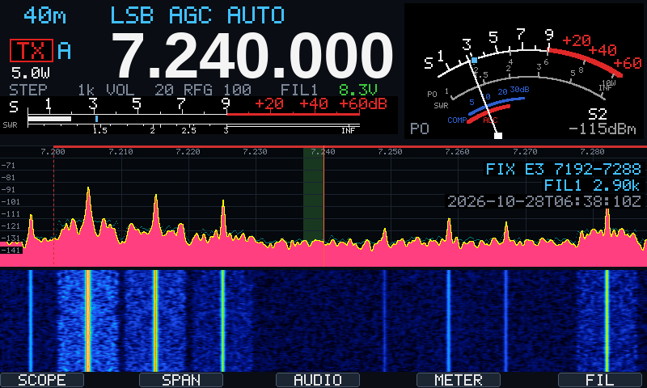

Four edges per range, the IC-705 ranges (MHz): 01 below 1.6, 02 1.6-2, 03 2-6, 04 6-8,
05 8-11, 06 11-15, 07 15-20, 08 20-22, 09 22-26, 10 26-30, 11 30-45, 12 45-60.

- F2 in FIX / SCROLL-F: next edge (1 -> 2 -> 3 -> 4 -> 1); the scope label shows
  `FIX E2 14096-14192`. The edge number holds for every range.
- F2 long in FIX / SCROLL-F: the edge in use becomes the window centred on the VFO, as
  wide as the CENTER span, on 1 kHz (set the span in CENTER first).
- An edge is at most 96 kHz wide (the IQ width); a wider one (CI-V) is cut to 96 kHz
  from its lower end.
- Defaults: 96 kHz windows from the bottom of the ham band in the range, the fourth at
  its top, each kept inside the band (20 m: 14000-14096, 14096-14192, 14192-14288,
  14254-14350); a range without a band uses the range itself.
- CI-V 27 16 (edge in use) and 27 1E (edge frequencies) set and read them, as wfview does.

## Scope panel (F1 long, IC-7851 style)

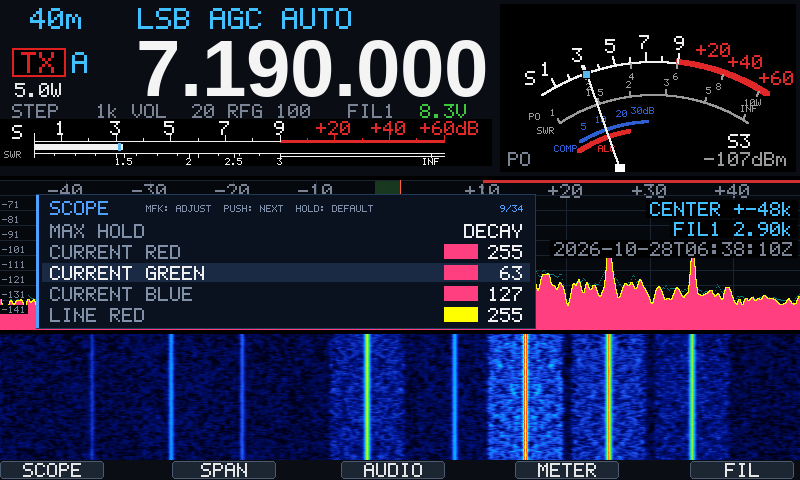

MFK turn: adjust; MFK push: next row; MFK hold: default; F1 long, another key or 10 s
idle closes. Kept in the state file (five lines: RF trace, RF colours, waterfall and TX, AF
trace, AF colours).

| Row | Values (default) | Console / state |
|---|---|---|
| MODE | CENTER, SCROLL-C, FIX, SCROLL-F (CENTER) | on the scope line |
| CENTER TYPE | FILTER, CARRIER (CARRIER): CENTER / SCROLL-C centred on the carrier or on the middle of the receive filter | `ctype filter\|carrier`; CI-V 27 1C |
| REF LEVEL | -30 to +30 dB (0): the RF scope reference level, in every scope mode (also F2 long in CENTER / SCROLL-C) | `ref` (CI-V 27 19 is the CAT scope's own level) |
| VBW | NARROW, WIDE (NARROW): narrow smooths over neighbouring bins | `vbw narrow\|wide`; CI-V 27 1D |
| AVERAGING | OFF, 2, 3, 4 (2): over frames | `scavg off\|2\|3\|4` |
| WAVEFORM TYPE | FILL, LINE, FILL+LINE (FILL+LINE) | `wave fill\|line\|fill+line` |
| MAX HOLD | OFF, DECAY, 10 S, ON (DECAY): DECAY falls slowly from each peak, 10 S holds the maximum for 10 s, ON holds it; tuning starts it again | `maxhold off\|decay\|10s\|on` |
| CURRENT RED / GREEN / BLUE | 0-255 (255, 63, 127): the fill | `fillr`, `fillg`, `fillb` |
| LINE RED / GREEN / BLUE | 0-255 (255, 255, 0) | `liner`, `lineg`, `lineb` |
| MAX HOLD RED / GREEN / BLUE | 0-255 (0, 127, 127) | `holdr`, `holdg`, `holdb` |
| WATERFALL | ON, OFF (ON) | `wf on\|off` |
| WATERFALL SPEED | SLOW, MID, FAST (FAST): a line every 4th / 2nd / frame | `wfspeed slow\|mid\|fast` |
| WATERFALL SIZE | SMALL, MID, LARGE (MID): the scope above takes or gives the rows | `wfsize small\|mid\|large` |
| WF PEAK LEVEL | 30-80 dB in steps of 10 (50): the range from the noise to the top colour | `wflevel 50` |
| SCOPE DURING TX | ON, OFF (ON): off keeps the last RX picture while transmitting | `txscope on\|off`; CI-V 27 1B |
| AF REF LEVEL | -30 to +30 dB (0): the audio scope reference level | `aref` |
| AF WAVEFORM TYPE, AF AVERAGING, AF MAX HOLD | as the RF rows, for the audio scope (F3) | `afwave`, `afavg`, `afhold` |
| AF CURRENT / LINE / MAX HOLD RED / GREEN / BLUE | 0-255, for the audio scope | `affillr` .. `afholdb` |

The defaults are the IC-7851 settings the scope was modelled on. The audio scope has its
own waveform, averaging, max hold and colours (AF rows); on the first start with them they
are copied from the RF rows. The waterfall rows apply to both scopes.

## Filter panel (F5 long, IC-705 style)

| Control | Action |
|---|---|
| MFK turn | adjust BW or SFT; on PBT: shift inner and outer together by 50 Hz |
| MFK push | select BW -> SFT -> PBT (AM: BW <-> PBT; FM: BW only) |
| MFK long | DEF (default for this FIL); on PBT: PBT CLR (inner and outer to centre) |
| F5 | next FIL |
| F5 long, other key, 10 s idle | close and save |

The PBT box shows `--` at centre, one value when inner and outer agree, else
inner / outer (amber while active). The edge text and graph show the passband
as PBT leaves it; BW / SFT stay the saved filter. PBT itself is not saved in
filters.conf (it is kept in the state file, as from wfview / CI-V 14 07 / 08).

Per mode group (SSB, SSB-D, CW, AM, FM), saved in `/etc/x6100/filters.conf`.
Maximum 6000 Hz (baseband audio runs at 12 kHz). AM / FM are symmetric.

| Group | FIL1 | FIL2 | FIL3 |
|---|---|---|---|
| AM / FM | ±3 kHz | ±2.5 kHz | ±2 kHz |

Saved values override the defaults; MFK long (DEF) restores them.

## DSP panel (DFL long)

The baseband's noise reduction, noise blanker and manual notch on one sheet.

| Control | Action |
|---|---|
| MFK turn | adjust the selected value |
| MFK push | next value: NR level, NB level, NB width, notch, notch width |
| MFK long | selected value back to its default |
| DFN short / long | NR / NB on, off (panel stays open) |
| DFL short | notch on, off (panel stays open) |
| DFL long, another key, 10 s idle | close |

Values are kept in the last state (see Settings); defaults NR 20, NB 10 / 10, notch 1000 / 50 Hz.

## Display

- A or B right of the TX box: the VFO in use; A/B and A=B also show a 1.5 s note in the middle of the scope (`A COPIED TO B`)
- TX box left of the frequency: red outline / red TX = RX, red fill / white TX = TX
- STEP and status fields right-aligned, fixed width
- S-meter: S0-S9, then S9+10 .. S9+60 in rounded 10 dB steps; dBm line exact
- AGC default AUTO; AM / FM SLOW (AUTO squashes AM)
- AM receives 500 Hz above the dial (AM OFFSET in the AGC long panel, console / conf
  `am_offset`, 0-1000, 0 = off): the baseband is zero
  IF and its DC notch takes part of the carrier when tuned exactly on it, which sounds
  distorted; the filter opens by the same amount, dial and TX stay on the carrier

  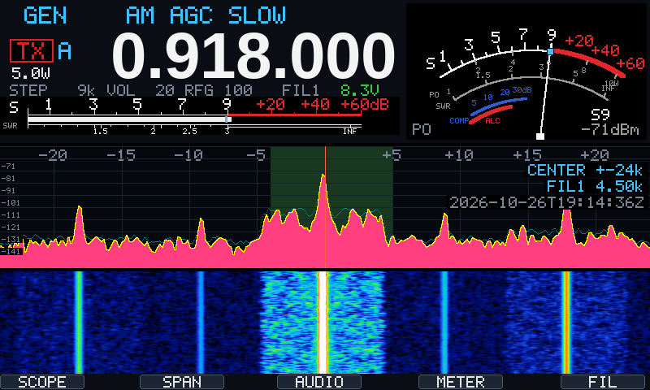

- F1-F5 tags along the bottom edge: SCOPE, SPAN, AUDIO, METER, FIL
- Audio scope (F3; F3 long: next to the RF scope, RF left / AF right): spectrum and waterfall of the demodulated RX audio (codec capture, 48 kHz), 0-3 or 0-6 kHz (F2), normalised dBFS scale (80 dB window, its bottom 10 dB under the noise floor measured inside the receive passband, so the picture stays put with volume and band noise; shifted by the AF reference level), receive passband shaded, MN line at the notch when on. The capture is opened only while the audio scope is shown
- Battery voltage (info line, right): green on external power (charging below 100 %),
  amber under 20 %, red under 10 %; a note on the scope at 20 % and 10 %
- OVF (red, top left of the dial): flow IQ at its clip level
- OOB (red, under OVF): band check off (`--oob` or `oob` in the conf) and tuned outside the region's allocations; where you transmit is your responsibility
- NB / NR / MN (blue, top right of the dial) in fixed places, e.g. `NB    MN`, `   NR   `, `NB NR MN`; MN = manual notch, as on Icom radios
- Tune panel (ATU long press / CAT): amber TUNING with live PO and SWR bars (SWR green / yellow / red), then green TUNED for 4 s with the time taken and the network (L, C, S in decimal, relay bits and hex)
- Clock under the filter label: system time, UTC, ISO 8601 (`2026-10-24T10:08:27Z`); hidden behind the filter panel while that is open. At start x6100_trx runs one NTP sync with the image's busybox `ntpd -q` (server: `ntp` in the conf, else /etc/ntp.conf, else pool.ntp.org) and reports the result on the console (a failure as a warning); skipped when the image syncs itself (init.d S48sntp / S49ntp, as on IU1WXY), when a time daemon runs, or with `ntp off`

## Settings panel (GEN)

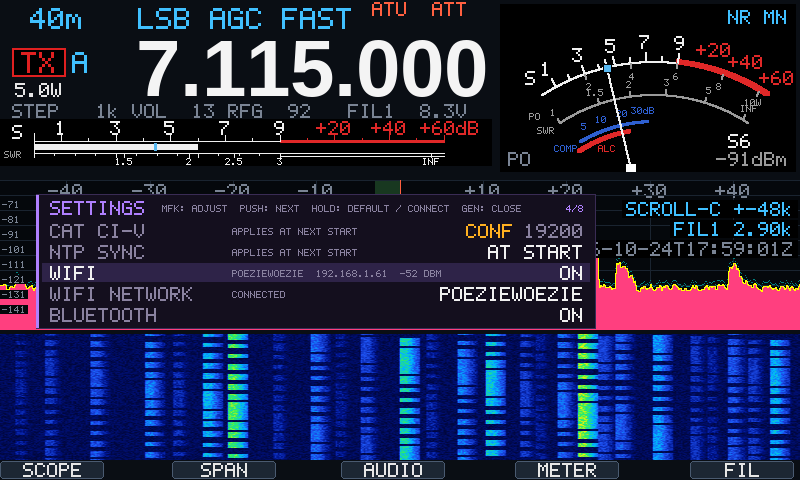

| Row | Values | When |
|---|---|---|
| BRIGHTNESS | 5-100 % in steps of 5 (default 100) | at once |
| CAT (CI-V) | OFF, 4800, 9600, 19200 (default 19200: the most the DEV port carries), PTY (/tmp/x6100-civ) | next start |
| CI-V ADDRESS | IC-705 A4 (default) / X6100 61 (wfview with `contrib/wfview/X6100.rig`); `civaddr` in the conf fixes it | at once |
| DATA OFF MOD | TX audio in SSB / AM / FM: MIC (default) / USB (the codec: audio from Linux, wfserver); PTT key and CAT PTT, the hand mic is always MIC; also CI-V 1A 05 0118; `modin` in the conf fixes both rows | at once |
| DATA MOD | the same for USB-D / LSB-D: USB (default) / MIC; CI-V 1A 05 0119 | at once |
| NTP SYNC | AT START / OFF | next start |
| WIFI | ON / OFF (NetworkManager); shows network, IP and signal | at once |
| WIFI NETWORK | turn: choose a saved network, hold MFK: connect. New networks: `nmtui` over ssh | at once |
| BLUETOOTH | ON / OFF | at once |
| BT PAIRING | turn right: visible as X6100 for 120 s to pair, left: hidden | at once |
| BT DEVICE | turn: choose a paired device, hold MFK: connect / disconnect | at once |
| BIRDIE SCAN | turn: THIS BAND / ALL BANDS, hold MFK: start (antenna off); any key stops | at once |
| BIRDIE MARKS | ON / OFF (ON): yellow ticks on the scope | at once |
| BIRDIE NOTCH | ON / OFF (OFF): automatic notch on a birdie in USB / LSB / AM | at once |

The panel shows five rows and scrolls with the selection (position top right). WiFi and
Bluetooth are the image's own (NetworkManager, bluez) and keep their state themselves;
brightness, CAT, NTP and the birdie switches go to `x6100_trx.state` at exit. A row set in `x6100_trx.conf` shows CONF and
cannot be changed here: the conf wins at start, so change it there.

GEN long: status page (IP address, battery with charge and external supply, CAT, last
NTP result, region, uptime, build).

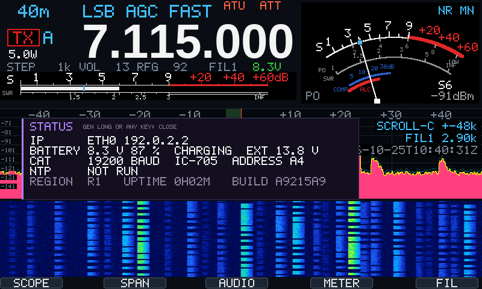

## Settings

Two files in `/etc/x6100`, both in console tokens (`#` = comment):

| File | Written by | Holds |
|---|---|---|
| `x6100_trx.state` | x6100_trx, at exit and after every tune | last state: frequency, mode, filter, VFO B, split, RIT / XIT, duplex, keyer, TX audio, volume / mute, gains, AGC per mode group, DSP, scope, REF, band memories, tuner memories |
| `x6100_trx.conf` | you, never x6100_trx | what must be the same at every start (example: `docs/x6100_trx.conf.example`) |
| `filters.conf` | filter panel | filter widths and shifts per mode group |
| `memories.conf` | memory panel / console | memory channels 1-99 |
| `birdies.conf` | birdie scan / console | birdies: `birdie <Hz> <dB>` |

At start: defaults, then `x6100_trx.state`, then `x6100_trx.conf`, then the command line;
later wins. Command-line values apply to that run only (but end up in the state at exit).

A new SD card image wipes `/etc/x6100`. On the PC:

```
sh ./build.sh backup     # radio -> ~/.config/x6100 (or $X6100_CONFIG), WiFi profiles included
sh ./build.sh restore    # ~/.config/x6100 -> radio, overwriting; restarts NetworkManager
                         # for the WiFi profiles (an ssh session over WiFi drops)
sh ./build.sh deploy     # also puts back settings the radio lacks (conf, memories: the examples)
```

## Console (ssh)

Type a line + Enter while running; tokens can be combined (`14074000 usb`).

What you type is shown at the end of the status line (`> memw 5`), so redraws do not
wipe it; Backspace and ^U (clear) work, Enter runs it and keeps it on its own line.
The status line is cut to the terminal width. It ends with the receive level and
battery (`iq -90.6 dB  bat 8.2V 87%`, `ext` on external power), while transmitting with
`TX 5.0 W  swr 1.2  alc 3`.

The status line starts with the VFO in use (A / B); with split, RIT or XIT it adds
`RX 7123.000 TX 7115.000 LSB SPLIT`; with a duplex shift `... NFM DUP-`.

| Token | Effect |
|---|---|
| `7074000`, `7.074`, `7074k` | frequency (Hz, MHz, kHz) |
| `usb lsb cw cwr am nfm` | mode |
| `off slow fast auto` | AGC |
| `att noatt pre nopre` | attenuator / preamp |
| `center scrollc fix scrollf` | scope mode |
| `fil1 fil2 fil3` | receive filter |
| `step 1\|10\|100\|1000\|5000\|9000\|10000` | tuning step (9000 / 10000 on LW / MW AM only) |
| `pwr 0.1-10` | TX power in W |
| `vol 0-100` | volume (also unmutes) |
| `nr nonr nb nonb notch nonotch` | noise reduction / blanker / notch on, off |
| `nrl 0-60`, `nbl 0-100`, `nbw 0-100` | NR level, NB level, NB width (start: 20, 10, 10) |
| `ntf 100-3000`, `ntw 10-100` | notch frequency, notch width in Hz (start: 1000, 50) |
| `ref -30-30`, `aref -30-30` | RF / audio scope reference level in dB (+ = trace up) |
| `rfg 0-100` | RF gain |
| `atu noatu` | tuner in / out |
| `rf af split`, `af3 af6` | scope view, audio range |
| `span 96000-3000` | scope span in Hz |
| `edge 1-4` | fixed edge in use (state) |
| `fixedge 6 2 14100000 14196000` | fixed edge: range 1-12, edge 1-4, lower and upper Hz (at most 96 kHz); state file holds the changed ones; `fixedge` alone lists the edges of the VFO range |
| `band 40m 7074000` | remembered frequency of a band |
| `agc ssb|ssbd|cw|am|fm off|slow|fast|auto` | AGC of a mode group |
| `atumem 7120000 L C S` | a tuner memory (state file; `atunet 40m L C S` from older ones still loads) |
| `mute nomute` | audio mute |
| `meter po\|swr\|alc` | TX meter on the dial (F4; state) |
| `cat 19200`, `cat pty`, `cat off` | CI-V at start (settings file; `--cat` overrides) |
| `civaddr a4`, `civaddr 61` | CI-V address: a4 IC-705 (default), 61 X6100 with `contrib/wfview/X6100.rig`; also the GEN row CI-V ADDRESS (state); in the settings file it fixes that row |
| `modin mic usb` | TX audio input DATA OFF MOD, DATA MOD: mic or usb (the codec, a Linux program such as wfserver); also the GEN rows (state); in the settings file it fixes them |
| `ntp <server>`, `ntp on`, `ntp off` | NTP sync at start (settings file) |
| `bright 5-100` | display brightness in % |
| `ab`, `a=b` | VFO A <-> B, A=B |
| `txsplit`, `notxsplit` | split on / off |
| `rit`, `norit`, `xit`, `noxit`, `ritofs -9990-9990` | RIT / XIT on / off, offset in Hz |
| `pbtin -1250-1250`, `pbtout -1250-1250` | twin PBT shifts in Hz (0 = centre; CI-V 14 07 / 08, wfview); in AM as a receive offset plus symmetric narrowing (the baseband filter is symmetric), not in FM; the FIL label shows PBT while it acts; `pbtin 0 pbtout 0` resets |
| `dupauto`, `dupoff`, `dup-`, `dup+`, `dupshift 10-10000` | repeater duplex, shift in kHz |
| `am_offset 500` | AM receive offset above the dial, 0-1000 Hz (0 = off); also AGC long, row AM OFFSET |
| `step ch` | 60 m channel steps |
| `memr` | list the used memory channels |
| `memr 5`, `memw 5`, `memc 5` | recall / write the VFO into / clear memory channel 5 |
| `mem 5 7074000 lsb fil1 [tx 7076000 lsb] [dupoff \| dup- 100 \| dup+ 100] [name text]` | set a memory channel (as in memories.conf) |
| `birdiescan [all]`, `birdiestop`, `birdies`, `birdieclear` | birdie scan (this band / all), stop, list, clear |
| `birdiemarks`, `nobirdiemarks`, `birdienotch`, `nobirdienotch` | birdie ticks, automatic notch on / off |
| `vfob 7074000 lsb fil1`, `vfo a\|b` | the VFO not in use; which one is in use (state file) |
| `region r1\|r2\|r3\|nl` | transmit allocations for the TX check and the OOB marker (default r1) |
| `oob`, `nolimit` | as `--oob` / `--no-limit` (settings file): warned at every start, red OOB on the dial |

## Messages (MSG)

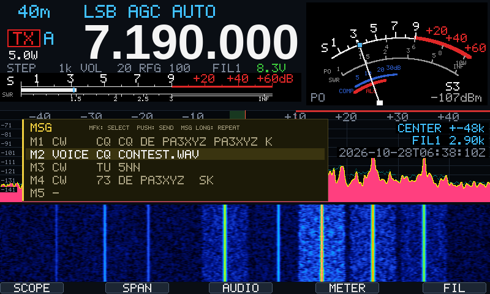

M1-M8, kept in `/etc/x6100/messages.conf` (example: `docs/x6100_messages.conf.example`).
Sent with the codec as TX audio (register 12 `0x4000`), not with the PTT:

- **CW** (`msg 1 cw CQ CQ DE PA3XYZ K`), in CW / CW-R only: a keyed tone at the CW
  pitch in USB with the VFO the pitch below the dial, so the carrier lands on the dial;
  keyer speed, smoothed edges (about 5 ms), about -10 dBFS. Letters, digits, / ? . , = + -.
- **Voice** (`msg 2 voice cq.wav`), not in CW: a WAV file in `/etc/x6100/voice`
  (48 kHz, 16 bit, mono or stereo), played at its own level in the mode in use. The
  microphone does not reach Linux: record the file on a PC.

MSG: panel (MFK turn: select; MFK push: send). MSG long: send the selected message,
then again every `msgrepeat` s (1-600, default 10) until a key. Any key or the PTT
key stops a message; TX timeout, SWR trip and the band check apply as on PTT. The scope
shows `MSG n` while sending, `MSG n AGAIN IN s S` between repeats.

Console: `msg` (list), `msg <n> cw <text>`, `msg <n> voice <file>`, `msg <n> clear`,
`msgrepeat <s>`, `msgsend <n>`, `msgstop`. CI-V 17 (send CW, from a logger or wfview) uses
the same CW sender: its text is added while it sends, 17 FF stops; the scope shows
`CAT CW`. `build.sh backup` / `restore` keep the
messages and the WAV files.

## SWR scan (APP)

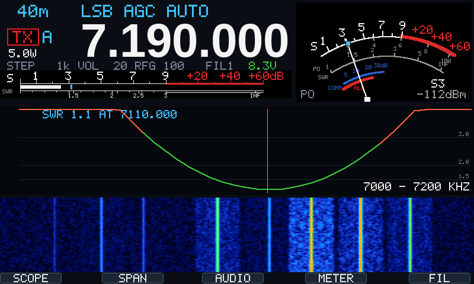

APP long, or APP and MFK push (console: `swrscan`): the baseband's own scan carrier
(register 12 `swrscan` 0x10 in AM at 5 W, no PTT and no microphone, as R1CBU's x6100_gui
keys it) stepped over the allocation segment the VFO is in (inside its band, region
table), 41 points of 300 ms, the SWR read in the second half of each; about 12 s. The curve replaces the RF scope
(SWR 1 at the bottom, 4 at the top, grid at 1.5 / 2 / 3, red above 3) with the lowest
point marked, until a key. Any key or the PTT key stops the scan; the curve so far
stays. The SWR trip is off during the scan (it measures).

## TX safety

- TX only inside the allocations of the region (`region` in the conf: r1, r2, r3, nl; default r1) and a band the baseband transmits in, unless `oob`
- TX timeout (TX panel, `tot`: off, 1, 3, 5 min; 3 out of the box): our PTT (key, CAT) drops;
  a TX keyed outside Linux (hand mic, VOX) cannot be dropped: TX enable (registers 0 / 6)
  goes off and the power to the minimum, and TX stays blocked until a key is pressed
  (`TX TIMEOUT: ANY KEY`; that key does nothing else; verified 2026-10-27). The power
  alone did not do it:
  the baseband kept 3 W after the cut (2026-10-27)
- a refusal or trip (OUT OF BAND, TX TIMEOUT, SWR HIGH, ...) shows on the scope for 10 s
  (or until the next TX); after a power cut (TOT on hand mic / VOX, stuck TX) 10 s from
  the end of the cut (verified 2026-10-27: TOT drops the PTT key TX; hand mic stays keyed)
- SWR above 3.0 for 300 ms drops TX
- any key except PTT and F1-F5 drops a latched TX; tune aborts on any key
- hand mic PTT keys the baseband directly; the display follows the TX flag. It does
  not abort a tune: Linux never sees it (flow flags show only b1 TX, 2026-10-24).
  Abort a tune with the PTT key, any other key or CAT PTT
- lost I2C writes (a NAK; OpenX6X00 base_guard.h: a lost PTT off kept a radio keyed): a
  failed write is sent again at once (3 tries), the other registers still go out and a
  failed one stays pending for the next pass; the whole register block goes out every
  second, after every un-key and after a write error; if the baseband is still in TX
  0.3-2 s after an un-key (up to 10 s after an error) the block goes out every 250 ms.
  Each event is a console line. Still in TX 2 s into a watch armed by a write error:
  power to the minimum (0.1 W) until the baseband is in RX (`TX STUCK: POWER MIN`).
  After 2 s of failed writes: our TX drops, new TX is refused (`I2C ERROR`) and
  x6100_trx keeps trying instead of quitting (nobody would send the PTT off); on
  recovery all registers go out again

## Birdies

Birdies are carriers from the radio's own oscillators: fixed narrow lines on the scope,
a whistle in SSB. A receive-only scan finds them; disconnect the antenna or use a dummy
load, and keep PRE / ATT as you normally listen.

- Start: GEN, row BIRDIE SCAN, turn for THIS BAND or ALL BANDS, hold MFK. Console:
  `birdiescan` (this band) or `birdiescan all`. Any key or `birdiestop` stops; TX is
  refused and the tuner is out (straight through) while it runs; the VFO and the tuner
  come back at the end.
- The scan steps 36 kHz windows over the band (80 m about 20 s, all bands about 6 min),
  averages 32 spectrum frames per window and keeps narrow peaks at least 10 dB over the
  noise. Progress shows on the scope (cyan); the console prints each birdie.
- Kept in `/etc/x6100/birdies.conf` (`birdie <Hz> <dB over the noise>`); a scan of a
  band replaces that band's entries. `birdies` lists them, `birdieclear` empties the
  list. Part of `build.sh backup`.
- BIRDIE MARKS: a yellow tick at the top of the RF scope at each birdie.
- BIRDIE NOTCH (off until checked on the radio): in USB, LSB and AM the baseband notch
  (40 Hz wide) sits on the strongest birdie in the passband and follows the tuning;
  shown as BN on the audio scope. Not in CW, digital or FM, and not while the notch is
  on by hand (DFL): that one wins. The baseband has one notch.

Own design; the idea of a birdie scan with an automatic notch comes from the IU1WXY
release notes (v0.128).

## Tuner memories

Every tune (ATU long, CAT) stores its network (L, C, S) with the TX frequency it was
tuned on, up to 200. With the tuner in, x6100_trx sets the network of the memory
nearest the TX frequency, within 0.5 % (9 kHz at 1.8 MHz, 35 kHz at 7 MHz, 70 kHz
at 14 MHz, 140 kHz at 28 MHz); outside that the tuner goes straight through until
you tune there. A new tune within half that window replaces the old memory. Split
and XIT count: the TX frequency decides. The console reports each tune:

```
ATU tuned at 7123.000 kHz: L=12 C=34 S=1 (7 tuner memories)
```

Kept in `x6100_trx.state` as `atumem <Hz> <L> <C> <S>`, written right after each tune
(so a backup or a power loss does not miss it) and at exit; part of `build.sh backup`.

## CW keyer (KEY)

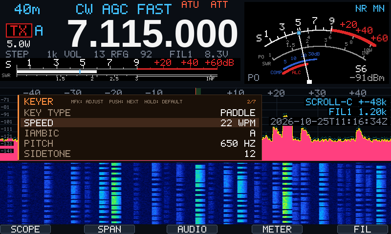

KEY short cycles the key type (note on the scope); KEY long opens the keyer panel
(orange): MFK turn = adjust, push = next value, long = default; KEY long, another key
or 10 s idle closes. The baseband keys and times the CW itself (registers 33 / 34).

| Value | Range (default) |
|---|---|
| KEY TYPE | STRAIGHT, PADDLE (dot on the left paddle), PADDLE REV (straight) |
| SPEED | 5-50 WPM (20) |
| IAMBIC | A / B (B, as Icom) |
| PITCH | 300-900 Hz in 10 Hz steps (600): sidetone and CW pitch, the IC-705 range |
| SIDETONE | volume 0-100 % in 5 % steps (20 %), full register range |
| BREAK-IN | delay 0-1000 ms in 10 ms steps (100) |
| RATIO | dash / dot 2.5-4.5 (3.0) |

Kept in the state file. Console: `keytype straight|paddle|rev`, `wpm 22`, `iambic a|b`,
`cwpitch 650`, `cwvol 25`, `qsk 150`, `ratio 3.2`. In CW the console status line shows
`22 wpm paddle`. CI-V: 14 0C (speed, 6-48 WPM), 14 09 (pitch, 300-900 Hz), 14 0F
(break-in delay, 0-1000 ms here).

## TX panel (F4 long)

F4 long opens the TX panel (red): MFK turn = adjust, push = next value, long = default;
F4 long, another key or 10 s idle closes. On / off rows show green when on. The
defaults are the values x6100_trx wrote at start before (from the R1CBU GUI; VOX gain
and delay are new, VOX stays off), so
nothing changes until a value is set. Ranges and register layout as in X6100Control
/ OpenX6X00 (the R1CBU line).

| Value | Range (default) | Register |
|---|---|---|
| MIC | INT, HAND, AUTO (AUTO) | 21 [1:0] |
| INT MIC GAIN | 0-50 (30) | 20 [23:16] |
| HAND MIC GAIN | 0-50 (20) | 20 [31:24] |
| COMPRESSOR | ON / OFF (OFF) | 25 [4] |
| COMP LEVEL | 1:2, 1:4, 1:8 (1:4) | 25 [3:0] |
| VOX | ON / OFF (OFF) | 22 [30] |
| VOX GAIN | 0-100 (50) | 22 [6:0] |
| ANTI-VOX | 0-100 (0) | 22 [14:8] |
| VOX DELAY | 100-2000 ms in 50 ms steps (500) | 22 [29:16] |
| MONITOR | ON / OFF (ON) | 29 (0 when off) |
| MONI LEVEL | 0-100 (30) | 29 |
| SQUELCH | 0-100 (0 = open) | 21 [15:8] |
| TX TIMEOUT | OFF, 1, 3, 5 MIN (3) | none: x6100_trx |

VOX keys the baseband itself, as the hand mic PTT: x6100_trx follows the TX flag, so
with split or duplex the first few ms go out on the RX frequency. Kept in the state
file. Console: `mic int|hand|auto`, `imicg 30`, `hmicg 20`, `comp on|off`,
`complvl 1:2|1:4|1:8`, `vox on|off`, `voxg 50`, `antivox 0`, `voxdly 500`,
`moni on|off`, `monilvl 30`, `sql 0`, `tot off|1|3|5`. CI-V: 14 03 / 0B / 0E / 15 / 16 / 17 (squelch,
mic gain, compressor level, monitor, VOX gain, anti-VOX), 16 44 / 45 / 46
(compressor, monitor, VOX).

## Memory channels (V/M)

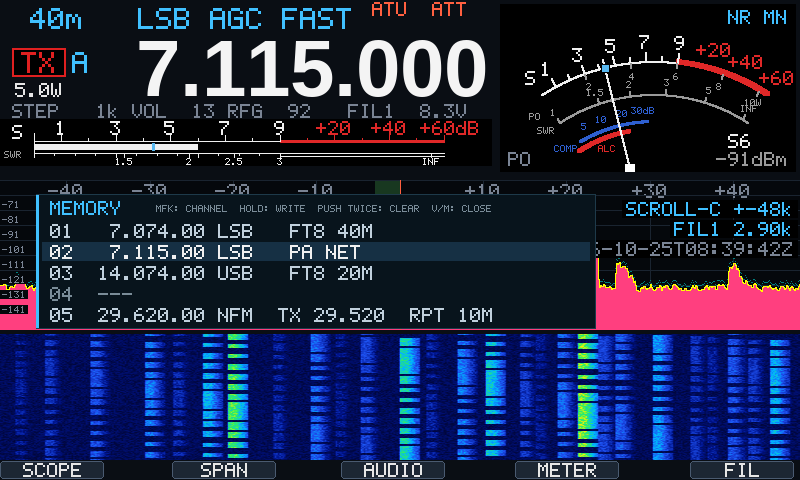

| Control | Action |
|---|---|
| V/M | open / close the memory panel |
| MFK turn | channel 1-99; a used channel is tuned at once (listen while scrolling) |
| MFK long | write the VFO in use into the channel (frequency, mode, filter; with split also the TX side; duplex unless AUTO); a rewrite keeps the name |
| MFK push, twice within 3 s | clear the channel |
| other key, 10 s idle | close; the VFO stays on the last channel tuned |

Kept in `/etc/x6100/memories.conf`, one channel per line, written on every change and
included in `build.sh backup`:

```
mem 3 7074000 lsb fil1 name FT8 40m
mem 5 29620000 nfm fil2 tx 29520000 nfm name RPT 10m
```

Names are set in that file, from the console (`mem ...`) or over CI-V (1A 00, e.g. a
memory editor in the CAT program); the radio has no keyboard. CI-V also selects and
tunes (08), writes the VFO (09), recalls (0A) and clears (0B) channels: see
`x6100_civ.md`.
`build.sh deploy` installs `docs/x6100_memories.conf.example` (FT8 on 160-6 m, a 60 m
spot, a 10 m repeater as a split channel) when the radio has no memories.conf and
there is no local backup.

`memr` on the console lists them:

```
 6   14074.000 kHz USB  fil1  FT8 20m
20   29620.000 kHz NFM  fil1  TX 29520.000 NFM  10m RPT 29.62
13 of 99 channels used
```

## Split, repeater duplex, RIT / XIT

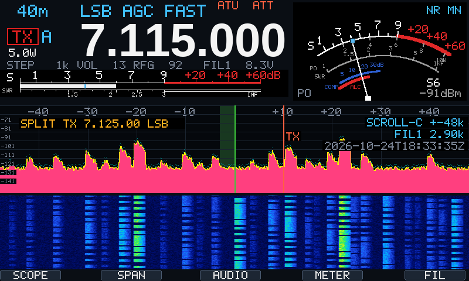

- V/M long: split. RX on the VFO in use (+ RIT), TX on the other VFO with its mode and
  filter (+ XIT). The TX check and the OOB marker use the TX frequency.
- AGC long: RIT / XIT / DUP panel (green). One offset for both, as on Icom radios: MFK
  turn = offset in 10 Hz steps (±9990), on the RIT / XIT rows on (right) / off (left);
  MFK push = next row; MFK long = offset 0 (CLEAR); AGC long, other key or 10 s closes.
- Repeater duplex, rows DUPLEX and SHIFT of the same panel: TX = RX - / + the shift,
  without split.

  | DUPLEX | TX |
  |---|---|
  | AUTO (default) | NFM on 29.620-29.680 MHz (10 m repeater outputs): RX - 100 kHz, shown as `AUTO -100 KHZ`; elsewhere simplex |
  | OFF | always simplex |
  | DUP- / DUP+ | RX - / + SHIFT (10-10000 kHz in 10 kHz steps, 100), any band and mode |

  MFK long on DUPLEX = AUTO, on SHIFT = 100 kHz. Split takes precedence over duplex.
  Tuning, the tuner memories, the TX check and the OOB marker use the TX frequency, as
  with split. No CTCSS: the baseband has no known tone encoder and the microphone
  audio does not pass through Linux, so repeaters that need a tone cannot be opened yet.
- AM OFFSET, the sixth row of the same panel (it scrolls, five rows in view): the AM
  receive offset, 0-1000 Hz in 10 Hz steps (500), MFK long = 500; green in AM.

  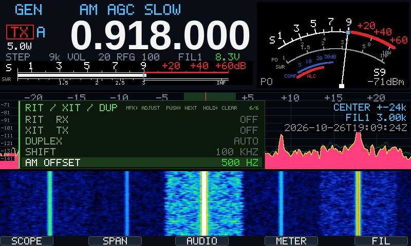

- Top left of the spectrum (amber): `SPLIT TX 7.120.00 LSB  RIT +120` or
  `DUP- TX 29.520.00` while in use; on
  the RF scope a green line at the RX frequency and a red one, marked TX, at the TX
  frequency when it is in view (a 100 kHz duplex shift is usually outside the span;
  the receive passband shading follows RIT). While transmitting with split or a
  duplex shift the frequency display shows the TX frequency (without XIT); the scope
  stays on RX.
- The baseband gets the TX frequency and mode just before PTT goes out and keeps it
  until the PTT drop has gone out. Front panel PTT, CAT PTT and tune follow split;
  the hand mic PTT keys the baseband directly: x6100_trx moves to the TX side as soon
  as the baseband reports TX, so the first few ms go out on the RX frequency (avoid
  the hand mic PTT with split across a band edge). Verified on the radio 2026-10-24:
  PTT key and hand mic both transmit on the split TX frequency.
- CI-V: 0F 00 / 01 (split), 0F 10 / 11 / 12 (simplex, DUP-, DUP+), 21 00 / 01 / 02
  (offset, RIT, XIT).

## 60 m channels (FST: CH)

FST to CH on 60 m: the MFK knob steps through the channels (RF gain / power wait
until you leave CH), the VFO knob fine-tunes around them in 100 Hz steps.

| Region | Channels (dial, USB) |
|---|---|
| r2 | 5330.5, 5346.5, 5357.0, 5371.5, 5403.5 (US; outside 5351.5-5366.5 TX needs oob) |
| r1, r3, nl | 5351.5, 5354.0, 5357.0, 5360.0, 5363.0 (no official channels in the WRC-15 segment: edge, FT8 and a 3 kHz raster as a convenience) |

## Regions (TX allocations)

| | 160 m | 80 m | 60 m | 40 m | 30-10 m | 6 m |
|---|---|---|---|---|---|---|
| r1 | 1810-2000 | 3500-3800 | 5351.5-5366.5 | 7000-7200 | 10100-10150, 14000-14350, 18068-18168, 21000-21450, 24890-24990, 28000-29700 | 50-52 MHz |
| r2 | 1800-2000 | 3500-4000 | 5351.5-5366.5 | 7000-7300 | as r1 | 50-54 MHz |
| r3 | 1800-2000 | 3500-3900 | 5351.5-5366.5 | 7000-7300 | as r1 | 50-54 MHz |
| nl | 1810-1880 | 3500-3800 | 5351.5-5366.5 | 7000-7200 | as r1 | 50-52 MHz |

kHz unless stated. The dial frequency is checked, not the edges of the signal. nl: F
registration (stcrt 2015-3772, 2021-31799; 60 m per WRC-15). National rules and power
limits are the operator's to know; national 60 m channels (e.g. US) are not in r2.

On the RF scope the selected region shows: a red bar along the top over what lies
outside its allocations, and a dashed red line at each band edge in view.
